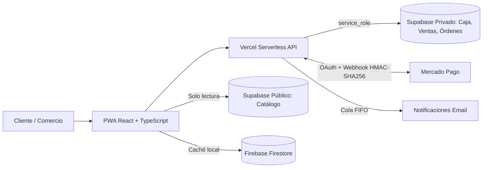

# Venthor — Caso de Estudio (POS, Inventario y Catálogo Online PWA)

> **Repositorio Showcase (sin código fuente):** Este repositorio documenta la arquitectura, el alcance funcional y las pruebas realizadas sobre **Venthor**. El código fuente se mantiene en repositorio privado por tratarse de un proyecto orientado a uso comercial.

---

## Resumen

- **Tipo:** Aplicación Web Progresiva (PWA) para comercios minoristas
- **Estado:** En piloto con comercio real (rubro papelería)
- **Mi rol:** Definición funcional, dirección del desarrollo asistido por IA, validación de seguridad, pruebas integrales y despliegue
- **Stack utilizado:** React, TypeScript, Vite, Tailwind CSS, Vercel Serverless Functions, Supabase (PostgreSQL + RLS), Firebase Firestore, Mercado Pago API, Nodemailer

---

## El problema a resolver

Muchos comercios chicos y medianos manejan ventas de mostrador, stock con variantes (talles, colores, presentaciones), múltiples cajas y pedidos por WhatsApp en planillas separadas o sistemas de escritorio rígidos, sin visibilidad online para sus clientes ni control de permisos por rol.

---

## Solución construida

Venthor unifica en una PWA instalable dos mundos separados por seguridad:

1. **Panel operativo privado (POS y Backoffice):**
   - Registro de ventas en mostrador, apertura y cierre de múltiples cajas y detalle de movimientos.
   - Gestión de inventario con matriz de variantes, alertas de reposición y cálculo de precios/márgenes.
   - Compras a proveedores, generación de comprobantes PDF y códigos QR.
   - Control de acceso granular por roles de usuario.

2. **Catálogo público online y pagos (`/catalogo`):**
   - Vista pública pensada para compartir por enlace o QR con clientes.
   - Integración de cobros online con **Mercado Pago** (preferencias de pago, OAuth y verificación automática por webhook).
   - Cola FIFO de notificaciones por correo ante nuevas órdenes y solicitudes de aviso de reposición.

---

## Enfoque técnico, seguridad y pruebas

- **Separación estricta entre datos privados y catálogo público:** Uso de políticas **Row Level Security (RLS)** en Supabase para que el rol público solo pueda leer el snapshot del catálogo y enviar solicitudes de reposición, dejando las tablas operativas y órdenes accesibles únicamente desde funciones serverless en Vercel (`service_role`).
- **Verificación de pagos por servidor:** Validación de firma `x-signature` (**HMAC-SHA256**) en el endpoint de webhook de Mercado Pago y verificación contra la API oficial antes de confirmar una orden.
- **Autenticación y resguardo de secretos:** Hashing de credenciales con PBKDF2, cookies de sesión, cabeceras de seguridad (`X-Frame-Options`, `nosniff`, CORS restringido al mismo origen) y sanitización de tokens al sincronizar o exportar respaldos.
- **Pruebas funcionales end-to-end:** Validación de flujos de venta, stock insuficiente, webhooks de pago, generación de PDFs y funcionamiento offline/caché en navegador.

---

## Arquitectura (Sin exponer código ni interfaz)

---

## Contacto

- **Email laboral:** `joaquindiazstefani00@gmail.com`
- **LinkedIn:** [Joaquín Díaz Stefani](https://www.linkedin.com/in/joaquindiazstefani)
